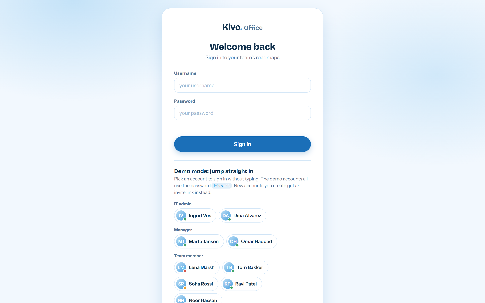
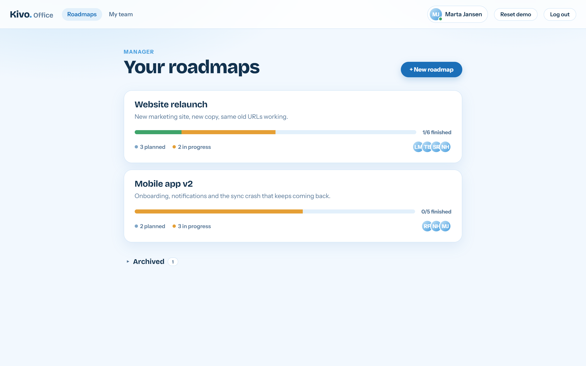
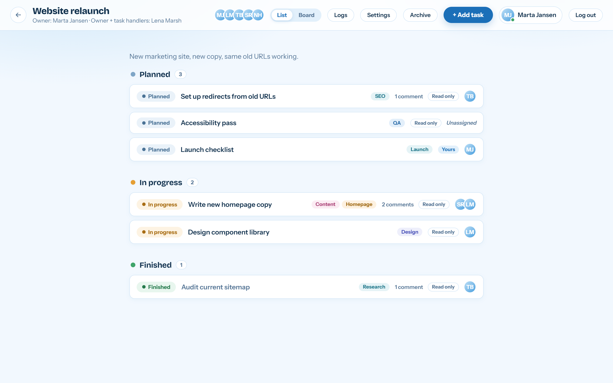
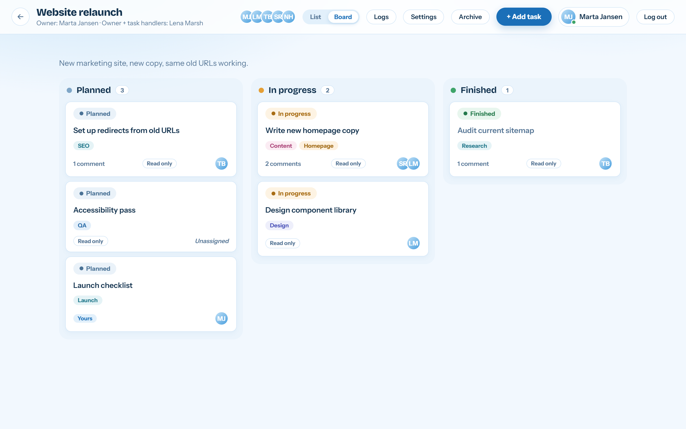
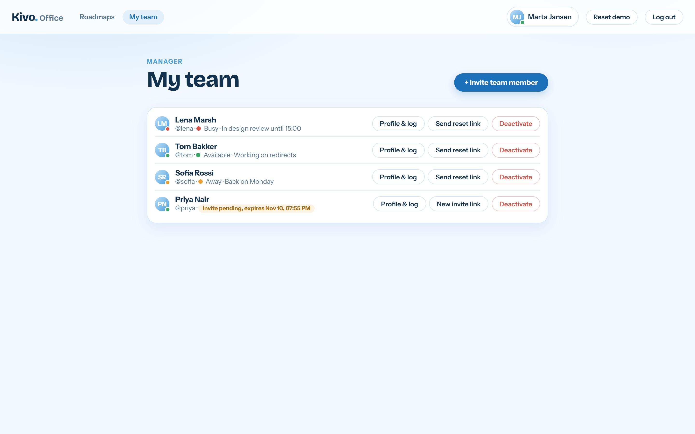
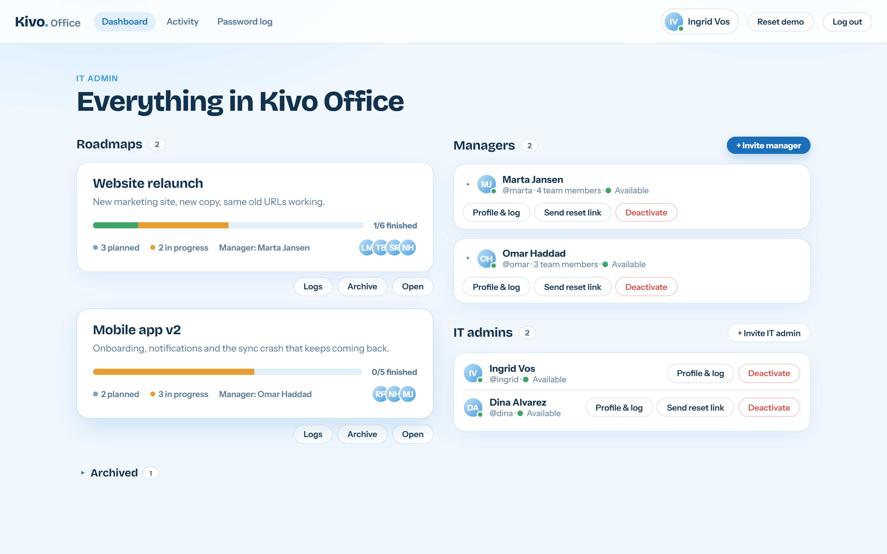
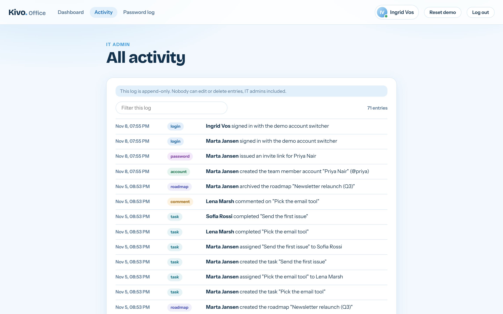
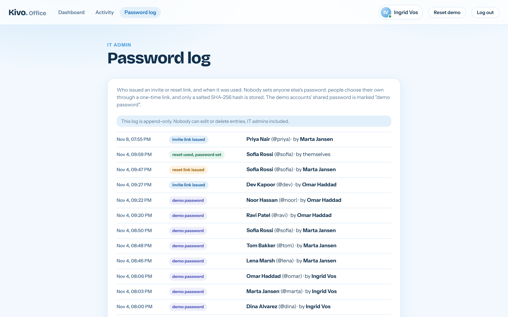

# Kivo Office (clickable prototype)

One self-contained file, `kivo-office.html`. No server, no install. It uses the current Kivo's look (same colours, fonts, buttons, modals, task rows) and shows the new office model: one company per install, IT admins, managers and members, invite links instead of handed-out passwords, roles per roadmap, and an append-only audit log.

## Screenshots

All data shown is the built-in demo data (fake people and roadmaps).

| | |
|---|---|
|  |  |
| Login with the demo account switcher | A manager's roadmaps |
|  |  |
| Roadmap, list view | Roadmap, board view |
|  |  |
| A manager's team | IT admin dashboard |
|  |  |
| Append-only activity log | Password log (invite and reset links) |

## Open it

Double-click `kivo-office.html`. It works from `file://` in any current browser. Fonts come from Google Fonts (as in current Kivo); offline it falls back to system fonts.

Data is stored in your browser's localStorage under `kivo-office-v1`. If storage is blocked, it still works but only until the tab closes (a notice appears on the login screen). **Reset demo** (top bar, or the link on the login card) wipes everything and restores the demo data. That is the only thing that can remove log entries, and only because it is a demo.

## Demo logins

The demo accounts all use the password `kivo123`, and the login screen has a switcher: click a name to jump in without typing. Accounts you create yourself have no password until the person opens their invite link.

| Role | Username | Name |
|---|---|---|
| IT admin | `ingrid`, `dina` | Ingrid Vos, Dina Alvarez |
| Manager | `marta` | Marta Jansen (roadmap "Website relaunch": owner + chosen task handlers, Lena) |
| Manager | `omar` | Omar Haddad (roadmap "Mobile app v2": everyone can create tasks; Marta is a member there) |
| Team member | `lena`, `tom`, `sofia` | Marta's team (Noor, Omar's member, is also on Marta's roadmap) |
| Team member | `ravi`, `noor` | Omar's team |
| Pending invite | `priya` | Invited by Marta, not activated yet |
| Expired invite | `dev` | Invited by Omar 4 days ago, never used |

## Try the invite flow

1. On the login screen click "Open a fresh invite (Priya Nair)", choose a password, and you are signed in as Priya.
2. Or, as Marta: My team, then "+ Invite team member". You get a link in a copy box (shown once). Open it (there is an "open the link here" shortcut), set a password, and the account is live. There is no email in a prototype, so you pass the link on yourself.
3. "Open an expired invite" shows the expired message. A used link shows "already used".
4. "Send reset link" on any account works the same way. Nobody ever types or sees anyone else's password.

Links last 48 hours and work once. Only a hash of the token is stored. The Password log (IT) lists: invite link issued, invite used, reset link issued, reset used, with who and when.

## Rules the prototype enforces (in the logic, not only the buttons)

- IT invites managers and other IT admins; managers invite members. A manager can add any active member or other manager to a roadmap, not only their own team. IT's dashboard still nests members under the manager who invited them.
- Roles inside a roadmap: owner (its manager), task handlers, members. "Who creates tasks" is a per-roadmap setting: Everyone on the roadmap, Manager only, or Manager + chosen task handlers.
- Only assigned people can edit a task. Status only moves forward (Planned, In progress, Finished; skipping ahead is fine). Every status change asks for confirmation. Only the roadmap owner can move a task back; that is logged as an override.
- Board and list: drag cards (mouse, pen or touch: hold a card briefly on a phone) to another column. The drop target lights up, or turns red if the move is not allowed.
- IT can read and comment on every roadmap, but not edit tasks.
- Accounts are never deleted: Deactivate / Reactivate. A deactivated person can't sign in and their session ends at once; they show as "Name (deactivated)"; their open tasks become unassigned and are flagged for the roadmap owner. A manager who still owns roadmaps or members must have them transferred (IT picks the new manager) first. The last active IT admin can't be deactivated.
- **Archive:** the roadmap's owner and IT can archive and unarchive a roadmap. Archived roadmaps leave the main lists and sit in a collapsible "Archived" section (separate from IT's "Deleted roadmaps"). They are read-only in the logic: no creating, editing, moving or assigning tasks, no comments, no settings, no delete, until unarchived. Both actions are logged.
- **Delete comments:** you can delete your own comment, a roadmap owner can delete any comment on their roadmap, IT can delete any. It asks for confirmation. The comment leaves the thread; the activity log gets "deleted <author>'s comment on <task>" (never the text), and no existing entry is touched.
- **Right-click menu** on tasks, roadmaps, people and comments shows only what you may do (it keeps the browser's menu on inputs and selected text). On touch, hold a roadmap, person or comment for about half a second. On a task card you can drag, holding picks it up (0.28 s); keep the finger still until 0.65 s and the card turns into the menu, move it and you are dragging.
- The audit log is append-only. No code path edits or removes an entry, there is no size cap, and deleting a roadmap only hides it (IT still sees it under "Deleted roadmaps" with its log). Blocked attempts are logged too.

## Demo-only things (the real app will not have them)

- **Reset demo** is available to everyone, from the top bar and the login card.
- The **quick account switcher** on the login screen signs you in as anyone without a password.
- The shared demo password `kivo123`.

## Limitations

- When someone hands over an invite or reset link by hand, whoever opens it can set the password. The real app will send links by email to the account's own address.
- Everything lives in one browser, and client-side hashing is not real security.
- If browser storage fills up or is blocked, a banner appears in the top bar: changes then only live in that tab until it is closed.

## License

Source-available, **not** open source. You may read the code, run it locally and contribute back through pull requests, but you may not redistribute, host or reuse it elsewhere. See [LICENSE](LICENSE).
